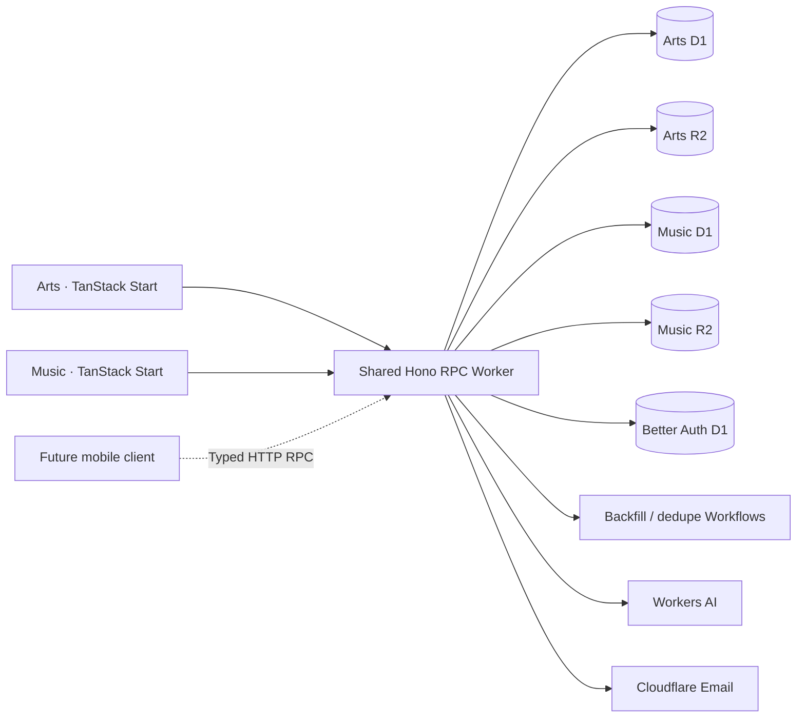

# Cloudflare migration — issue #167

The existing applications are ported in place. `apps/arts` keeps its TanStack Start UI; `apps/web` keeps its page bodies, components, styles, assets, and URLs while replacing Next.js routing/server operations with native Start routes and Hono RPC. The old migration worktree and Better T Stack reference were used for comparison, not as replacement applications.

## Architecture

| Worker           | Package     | Bindings                                                   |
| ---------------- | ----------- | ---------------------------------------------------------- |
| `deadpartyarts`  | `apps/arts` | API service binding                                        |
| `deadpartymedia` | `apps/web`  | API service binding                                        |
| `deadparty-api`  | `apps/api`  | Arts D1/R2, music D1/R2, identity D1, Email, AI, Workflows |



Identity is shared. Authorization is not global: `app_membership` keys roles by user and application. Every protected API operation checks the relevant application's membership and ownership. An arts administrator has no music administration privilege without a music membership. Product profile rows remain separate. Better Auth identity changes update existing profile projections without creating cross-app memberships.

Frontends have no database credentials or database bindings. Server loaders use the service binding with the caller's headers; browsers use same-origin API proxies. `packages/api-client` exposes Hono's inferred client types and `parseResponse`. Future mobile clients can use the same public RPC endpoints and Better Auth Expo integration. The future awards app can add its own router, membership namespace, D1, and R2.

D1 stores relational data, JSON values as SQLite JSON text, timestamps as milliseconds, and booleans as integers. R2 owns media. There is no KV requirement at this volume. D1 batches implement atomic imports, merges, deduplication, and invitation consumption. Long-running WordPress imports/deduplication use native Workflows; AI uses a native Workers AI binding. Fourthwall and Spotify remain external services.

## Current verification and rollout state

Production DNS, Vercel deployments, Clerk, Neon data, and the existing production arts R2 bucket have not been changed by this migration. The other agent's empty plural Better Auth tables in Neon were inventoried and left untouched. No production SQL push or schema migration was performed.

An isolated `pr-167` Cloudflare stack is deployed:

- [Music preview](https://deadpartymedia-pr-167.rocktown-labs.workers.dev)
- [Arts preview](https://deadpartyarts-pr-167.rocktown-labs.workers.dev)
- [API health](https://deadparty-api-pr-167.rocktown-labs.workers.dev/healthz)

The read-only PostgreSQL snapshot imported into local and preview D1 with **zero foreign-key violations**:

| Domain                       | Source rows                                                                                                   |
| ---------------------------- | ------------------------------------------------------------------------------------------------------------- |
| Arts                         | 28 referenced/scoped users, 26 artmakers, 171 artworks, 2 venues                                              |
| Music                        | 11 referenced/scoped users, 159 artists, 80 posts (72 published, 8 drafts), 12 events, 2 venues               |
| Music relationships/activity | 85 post-artist links, 68 event-artist links, 1 comment, 20 reads, 1 save, 80 import records, 12 backfill runs |

The complete source has 37 user rows; domain exports deliberately select relevant users rather than duplicating every profile into both databases. Preview-only review identities are additional test fixtures.

Verified behavior includes populated home pages on desktop/mobile, arts admin, music admin and article editor, an existing full article and canonical metadata, native password authentication, scoped access denial, invitations/replay checks, D1 editorial writes, native R2 upload/read bytes, and an empty native Workflow run. Tests run inside workerd for the API, including bcrypt credentials retaining original Clerk IDs. The request clock is serialized through root loaders to avoid Workers' epoch date during module evaluation.

**Live cutover remains pending:** obtain the production Clerk password CSV and production API metadata snapshot, review the per-app membership map, configure production Google/email/commerce credentials, import and verify production D1/R2, then attach domains. The locally available Clerk key belongs to a test instance and must not be used as the production user inventory. OAuth callbacks, outbound mail, paid AI inference, and live Fourthwall checkout need verification with their production configurations.

## Development and quality gates

Use Node 24 and the pinned pnpm version. Copy `packages/infra/.env.example` to its ignored `.env`; set a random stable `BETTER_AUTH_SECRET` of at least 32 characters. Use separate secrets for preview and production. Public frontend build variables have their own `.env.example` files.

```sh
pnpm install --frozen-lockfile
pnpm dev --stage local
pnpm check
pnpm typecheck
pnpm test
pnpm --filter web build
pnpm --filter arts build
pnpm --filter web exec playwright install chromium
pnpm --filter web test:e2e --project chromium --project 'public tests'
```

Local API/web/arts ports are 3000/3001/3002. Use a different stage for remote previews so deployment never replaces local state. Alchemy is pinned because its API is currently beta. Configuration Effects used as resource properties must be lifted with `Output.fromEffect`; bare Effect values are opaque to the planner. Production data resources have retention policies.

The installed Cloudflare `cf` CLI is not available on this machine. This implementation uses Alchemy and native Cloudflare REST APIs. No Wrangler CLI migration or fallback was used. The obsolete Neon auto-migration GitHub workflow is removed; CI checks native D1 migrations inside workerd and never pushes a schema into production on merge.

## Deploying an isolated preview

Authenticate Alchemy to the intended Cloudflare account, then inspect the plan before applying:

```sh
pnpm infra:plan --stage pr-167
pnpm run deploy --stage pr-167 --yes
```

Every non-production resource gets the stage suffix. `WORKERS_SUBDOMAIN` defaults to the verified account subdomain `rocktown-labs`. App URLs/trusted origins derive from the stage, with explicit overrides available. Domain attachment defaults off. Do not deploy a remote stack into the same stage as a running local stack.

## Data and media migration

Keep exports, credentials, hashes, and SQL outside the repository, with owner-only permissions. The tools default to planning/exporting; no exporter applies production writes.

1. Export PostgreSQL using a read-only transaction and preserve the immutable snapshot:

   ```sh
   MIGRATION_SOURCE_DATABASE_URL='<source URL>' pnpm migration:export --out /private/path/migration
   ```

   This produces `source.export.json`, `arts.data-import.sql`, and `music.data-import.sql`. IDs, author references, arrays, dates, media URLs, and join rows are preserved. Exporters fail on unsupported data rather than silently dropping it. Re-run after the final content freeze to capture the final source state.

2. Deploy native schema migrations into the target stage through Alchemy. Obtain the target database IDs from that stage's state or Cloudflare account inventory. Use a scoped token through `CLOUDFLARE_API_TOKEN` (never put it in command arguments):

   ```sh
   pnpm --filter @dpmedia/infra migration:import --sql /private/path/migration/arts.data-import.sql --database-id '<arts UUID>' --expected-name deadpartyarts-pr-167 --account-id '<account UUID>'
   # Add --apply after checking the dry-run target; repeat for music/auth.
   ```

   The native importer checks the database name before writes, applies bounded batches, and runs `PRAGMA foreign_key_check`. Domain SQL uses upserts for repeatable rehearsal. It does not delete target-only rows; use a fresh preview for a clean rehearsal and a source write freeze for final cutover.

3. Mirror owned Vercel Blob and Clerk media into the appropriate R2 bucket:

   ```sh
   pnpm --filter @dpmedia/infra migration:media --sql /private/path/migration/music.data-import.sql --bucket deadpartymedia-pr-167 --public-base https://deadpartymedia-pr-167.rocktown-labs.workers.dev/api/media
   # Add --account-id '<account UUID>' --apply to perform the copy.
   ```

   The tool downloads supported media with bounded size/time, uses deterministic keys, verifies uploaded bytes by SHA-256, saves a private resume manifest, re-verifies resumed objects, and produces a separate `music.r2.data-import.sql`. Import that rewritten SQL into the target D1. The rehearsal copied and SHA-256 verified all 131 owned music assets, then imported the rewritten URLs into preview D1. Apply the same process to auth SQL if it contains Clerk-hosted avatars. Existing public arts R2 URLs remain valid; adopting the existing production bucket preserves those objects and its recorded public-access/CORS/lifecycle settings.

## Clerk → Better Auth

Read the [official Clerk migration guide](https://better-auth.com/docs/guides/clerk-migration-guide). Export production password hashes through Clerk's dashboard and a read-only API snapshot containing each user's metadata, timestamps, disabled state, and external accounts. Never substitute the local test instance export.

Create an explicit reviewed membership map for migration of both apps:

```json
{
  "user_original_clerk_id": {
    "arts": ["artmaker"],
    "music": []
  }
}
```

```sh
pnpm migration:clerk --csv /private/path/exported_users.csv --snapshot /private/path/clerk-users.json --app both --memberships /private/path/memberships.json
# To write SQL, add --output /private/path/auth.data-import.sql
```

The planner preserves Clerk user IDs and provider account IDs, verifies supported bcrypt formats, imports disabled flags, and refuses missing metadata/hashes, unsupported password formats, MFA downgrade, or implicit cross-app grants. Passwords remain usable through bcrypt verification; new Better Auth passwords use its native hashing. Existing Clerk sessions cannot become Better Auth sessions: users must sign in again. Google requires callback URLs for each frontend at `/api/auth/callback/google`. Configure and test reset/verification/change-email messages from the verified Cloudflare sending domain before switching authentication.

Auth imports use conflict protection rather than overwriting an existing identity's credentials. Rehearse on fresh auth D1, inspect counts and membership differences, and test representative migrated password/OAuth accounts before production. Do not edit the empty experimental production PostgreSQL auth tables as part of this import.

## Production cutover and rollback

1. Keep the current Vercel/Clerk/Neon deployment available. Inventory the production plan and existing bucket settings. Use Alchemy's explicit `--adopt` only for the verified pre-existing arts R2 bucket; physical production names stay exact.
2. Deploy stage `production` with `BIND_DOMAINS=false`. Import the final frozen domain snapshot, media, and reviewed identity/membership export. Verify row counts, IDs, representative content, private admin views, editor writes, R2 reads, login methods, email, and checkout. Verify that an arts-only role cannot authorize music writes.
3. Attach domains only after those checks. `BIND_DOMAINS=true pnpm run deploy --stage production --adopt --yes` configures arts plus canonical `www.deadpartymedia.com`, with apex redirect. The API remains accessible for mobile; frontends use service bindings. Audit trusted origins and Google callback settings against final domains.
4. Keep source systems during a rollback window. Record the cutover time and freeze old writes. Do not dual-write auth credentials. If rolling back before new writes, restore the previous DNS/deployment. If Cloudflare has received writes, freeze writes, export D1/R2 changes and reconcile them into the old system before restoring write access; a DNS rollback alone would lose those writes. New Better Auth-only credentials require their own recovery plan before restoring Clerk.
5. Decommission Vercel, Neon, Clerk, old Blob assets and the old `dpmedia-api` Worker only after reconciliation and the rollback window. Do not destroy retained production D1/R2 resources with a stack cleanup.

## References

- [TanStack in-place migration](https://tanstack.com/start/latest/docs/framework/react/migrate-from-next-js)
- [Hono best practices](https://hono.dev/docs/guides/best-practices)
- [Hono RPC](https://hono.dev/docs/guides/rpc)
- [Cloudflare storage options](https://developers.cloudflare.com/workers/platform/storage-options/)
